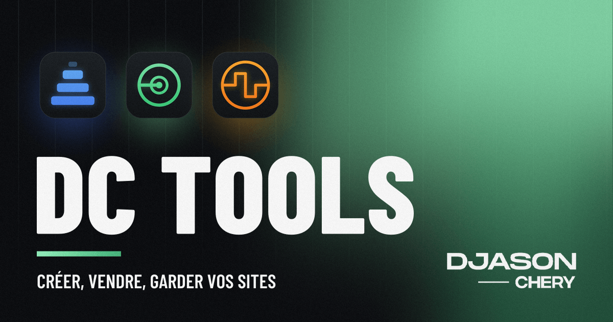

# DC Tools

[English](README.md "Read in English")

Trois applications pour indépendants et petites entreprises, sur Windows, macOS et Linux. Gratuites, avec une offre Pro.
Tout est expliqué sur **[tools.djason-chery.dev](https://tools.djason-chery.dev/fr/ "Site des outils DC")**.

| Outil | Ce qu'il fait | Télécharger |
|---|---|---|
| **DC Scaffold** | Crée un projet web complet en quelques minutes : un site et son serveur, reliés, documentés et prêts à démarrer. | [Versions `scaffold-v…`](https://github.com/Djason16/dc-releases/releases?q=scaffold&expanded=true "Versions de DC Scaffold") |
| **DC Prospect** | La prospection par e-mail faite à votre place : trouve les entreprises, lit leur site, rédige avec votre ton, envoie après votre accord. | [Versions `prospect-v…`](https://github.com/Djason16/dc-releases/releases?q=prospect&expanded=true "Versions de DC Prospect") |
| **DC Sentinel** | Surveille vos sites et sauvegarde leurs bases de données, ordinateur éteint, depuis votre propre compte GitHub. | [Versions `sentinel-v…`](https://github.com/Djason16/dc-releases/releases?q=sentinel&expanded=true "Versions de DC Sentinel") |

Le plus simple pour avoir le bon fichier : la **[page de téléchargement](https://tools.djason-chery.dev/fr/download/ "Télécharger les outils DC")**.

## Windows ou macOS bloque l'installation ?

Les installeurs ne sont pas encore signés.

- **Windows** : « Windows a protégé votre ordinateur » → **Informations complémentaires** → **Exécuter quand même**.
- **macOS** : la première fois, **Réglages Système** → **Confidentialité et sécurité** → **Ouvrir quand même** (ou clic droit sur l'application → **Ouvrir**).
- **Linux** : rendez l'AppImage exécutable (`chmod +x`), puis ouvrez-la.

## Aide, Pro et licence

- Offres Pro, essai de 14 jours et aide : [tools.djason-chery.dev](https://tools.djason-chery.dev/fr/ "Site des outils DC").
- Gérer une clé de licence : [djason-chery.dev/licenses/manage](https://djason-chery.dev/licenses/manage/?lang=fr "Gérer ma licence").
- Les applications sont des logiciels propriétaires (contrat de licence utilisateur final fourni avec chaque application).
  Ce dépôt contient seulement les installeurs et leurs notes de version ; le code source est privé.

© Djason Chery, tous droits réservés.
