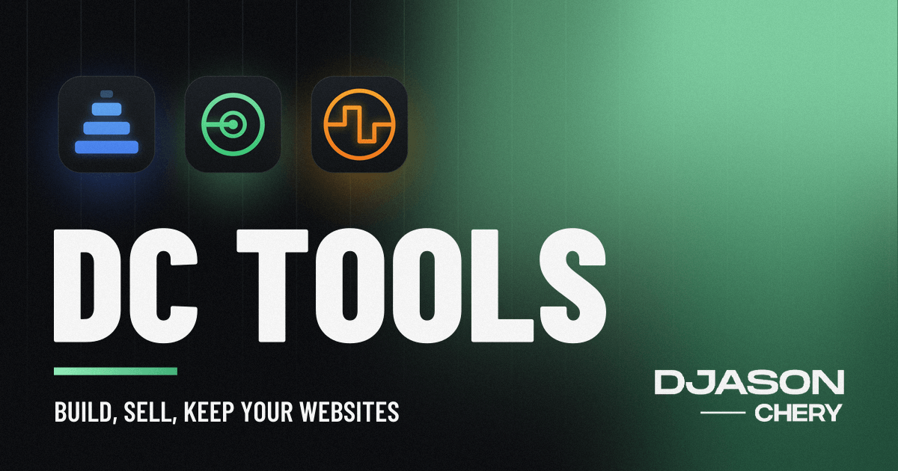

# DC Tools

[Français](README.fr.md "Lire en français")

Three desktop apps for freelancers and small businesses, for Windows, macOS and Linux. Free, with a Pro plan.
Everything about them is on **[tools.djason-chery.dev](https://tools.djason-chery.dev/en/ "DC Tools website")**.

| Tool | What it does | Download |
|---|---|---|
| **DC Scaffold** | Creates a complete web project in minutes: a front and a back end, connected, documented and ready to start. | [Releases `scaffold-v…`](https://github.com/Djason16/dc-releases/releases?q=scaffold&expanded=true "DC Scaffold releases") |
| **DC Prospect** | E-mail prospecting done for you: finds companies, reads their site, drafts in your voice, sends after your approval. | [Releases `prospect-v…`](https://github.com/Djason16/dc-releases/releases?q=prospect&expanded=true "DC Prospect releases") |
| **DC Sentinel** | Watches your websites and backs up their databases, computer off, from your own GitHub account. | [Releases `sentinel-v…`](https://github.com/Djason16/dc-releases/releases?q=sentinel&expanded=true "DC Sentinel releases") |

The easiest way to get the right file: the **[download page](https://tools.djason-chery.dev/en/download/ "Download the DC tools")**.

## Windows or macOS blocks the install?

The installers are not signed yet.

- **Windows**: « Windows protected your PC » → **More info** → **Run anyway**.
- **macOS**: the first time, **System Settings** → **Privacy & Security** → **Open Anyway** (or right-click the app → **Open**).
- **Linux**: make the AppImage executable (`chmod +x`), then open it.

## Help, Pro and licence

- Pro plans, 14-day trial and support: [tools.djason-chery.dev](https://tools.djason-chery.dev/en/ "DC Tools website").
- Manage a licence key: [djason-chery.dev/licenses/manage](https://djason-chery.dev/licenses/manage/?lang=en "Manage my licence").
- The apps are proprietary software (end-user licence agreement shipped with each app). This repository only hosts
  the installers and their release notes; the source code is private.

© Djason Chery, all rights reserved.
